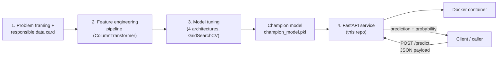

# Real-Time ML Inference REST API — Credit Default Risk

A production-style REST API that serves the champion credit-default-risk model as a
`/predict` endpoint, containerized with Docker, with unit tests validating request
schema and response codes. This is the capstone stage of a multi-part project — see
"End-to-end system architecture" below for how it connects to the earlier stages.

## Contents

| Path | Purpose |
|---|---|
| `train_model.py` | Generates the (synthetic, seeded) training data and saves the fitted pipeline |
| `model/champion_model.pkl` | The trained model artifact the API loads at startup |
| `app/main.py` | FastAPI app — `/predict` and `/health` endpoints |
| `app/schemas.py` | Pydantic request/response models (validation + auto-generated docs) |
| `app/model.py` | Loads the model once and runs inference |
| `tests/test_api.py` | Unit tests: schema validation and HTTP response codes |
| `Dockerfile` | Containerizes the service with pinned dependencies |
| `requirements.txt` | Pinned Python dependencies |

## End-to-end system architecture

This API is the last stage of a pipeline built across several notebooks/stages:



- **Input:** a JSON payload describing one loan applicant (age, income, loan amount,
  credit score, debt-to-income ratio, employment type, state).
- **Preprocessing:** happens inside the loaded pipeline itself — the same
  `ColumnTransformer` (imputation, scaling, one-hot/target encoding) fit during
  training runs automatically on every request, so there's no separate
  preprocessing step to keep in sync.
- **Model:** the champion classifier selected in the model-tuning stage (XGBoost if
  installed, otherwise scikit-learn's Gradient Boosting as an automatic fallback —
  see `train_model.py`).
- **Output:** predicted class (0/1), the model's probability of default, and a
  human-readable risk bucket (Low/Medium/High).

`train_model.py` in this repo regenerates the same synthetic dataset and pipeline used
in the earlier feature-engineering and model-tuning notebooks, so this API can run
standalone. Swap it for a real training script + real data before using this for an
actual lending decision — see the Responsible Data Card and Risk Register from the
first stage of this project for what that requires.

## API reference

### `POST /predict`

Request body:
```json
{
  "age": 35,
  "income": 55000,
  "loan_amount": 15000,
  "credit_score": 680,
  "debt_to_income": 0.25,
  "employment_type": "Salaried",
  "state": "ST03"
}
```
`loan_amount` and `state` are required; every other field is optional (the underlying
pipeline imputes missing values the same way it was trained to).

Response body:
```json
{
  "prediction": 0,
  "probability_default": 0.2239,
  "risk_label": "Low"
}
```

Invalid input (missing required field, wrong type, or an out-of-range value like a
credit score above 850) returns HTTP `422` with details on what failed validation.

### `GET /health`
Returns `{"status": "ok", "model_loaded": true}` — used for container health checks.

Full interactive docs (Swagger UI) are auto-generated by FastAPI at `/docs` once the
service is running.

## Running locally (no Docker)

```bash
pip install -r requirements.txt
python train_model.py          # trains and saves model/champion_model.pkl
uvicorn app.main:app --reload --port 8000
```
Then open http://localhost:8000/docs in a browser, or:
```bash
curl -X POST http://localhost:8000/predict \
  -H "Content-Type: application/json" \
  -d '{"loan_amount": 15000, "state": "ST03", "credit_score": 680}'
```

## Running the tests

```bash
pip install -r requirements.txt
python train_model.py          # tests need model/champion_model.pkl to exist
pytest tests/ -v
```

## Running with Docker

```bash
python train_model.py                              # build the model artifact first
docker build -t credit-risk-api .
docker run -p 8000:8000 credit-risk-api
```
Then visit http://localhost:8000/docs the same as above. The container's
`HEALTHCHECK` hits `/health` every 30 seconds.

## Known limitations

- Trained on synthetic data (see `train_model.py`) — not a real risk model.
- No authentication on the endpoints; add an API key or OAuth layer before any
  real deployment.
- No request logging/monitoring wired up yet — see the Risk Register from the
  problem-framing stage for the monitoring and rollback plan this API would need
  before being used for a real lending decision.
